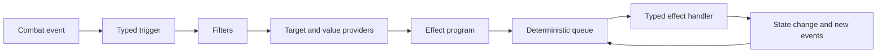

# RogueDeck Core

A deterministic, modular C#/.NET engine for roguelike deckbuilders. It covers combat, the run around it, a
bot that plays and replays runs, and RogueDeck Studio, a browser editor for building a game without code.
The engine has no rendering, input or theme of its own; a frontend hosts it.

[](https://github.com/Paranoidgrinch/RogueDeck-Core/actions/workflows/ci.yml)

[](LICENSE)

## Design

The central rule: adding a new effect must not require changing the central resolver. In practice that means

- no central switch over concrete effects,
- no hardcoded fields such as `PoisonStacks`, `IsStunned` or `Thorns`,
- no game-specific rules inside turn processing,
- no effect that bypasses the deterministic queue.

A mechanic is added through its own definitions, handlers, providers and packages. Triggered mechanics are
split into five parts:

```text
WHEN       What happened?
IF         Which conditions must match?
WHO        Which combatants are affected?
HOW MUCH   How is the value calculated?
WHAT       Which primitive effect is requested?
```

An existing event can be combined with an existing effect without a new engine class:

```text
WHEN damage is received          WHEN a skill card is played
IF   the target has Thorns       IF   it is the second skill this turn
WHO  the attacker                WHO  the player
HOW  the current Thorns value    HOW  1
WHAT deal damage                 WHAT draw cards
```

### Resolution



Effects and events are processed through the queue until the chain is complete or combat ends. Chain
ancestry, re-entry rules and configurable depth limits prevent accidental infinite loops. The combat state can
be hashed at any point, so identical inputs can be shown to produce identical outcomes.

## Getting started

Requirements: [.NET 10 SDK](https://dotnet.microsoft.com/download/dotnet/10.0).

```bash
git clone https://github.com/Paranoidgrinch/RogueDeck-Core.git
cd RogueDeck-Core
dotnet test          # about 2,700 tests
```

CI runs the suite on Windows and Linux, checks formatting with `dotnet format` and builds the benchmarks on
every push and pull request to `main`.

### RogueDeck Studio

The Studio runs in the browser at [studio.moonvineforge.com](https://studio.moonvineforge.com) (Blazor
WebAssembly, deployed from `src/RogueDeck.Studio.Web`). To run it locally:

```bash
dotnet run --project src/RogueDeck.Studio
```

A project is one document edited through separate tabs: hero, characters, cards, statuses, enemies and
encounters, relics, events, shops, consumables, workbenches and recipes, map rules, meta progression and
balance. The Playtest tab plays the current document on the engine. Effect programs are edited visually,
drafts are saved automatically, and the result is exported as a versioned `game.roguedeck.json` blueprint.

### Writing a fight in code

`RogueDeck.Scenario` describes a fight as blueprints and scripted turns, runs it on the real combat loop and
renders a readable log:

```csharp
using RogueDeck.Core.Combat;
using RogueDeck.Scenario.Authoring;
using RogueDeck.Scenario.Dsl;
using RogueDeck.Scenario.Reporting;
using RogueDeck.Scenario.Scripting;

var fight = new ScenarioBlueprint();

// A card: deal 8 damage to the chosen target, for 1 energy.
fight.Cards.Add(new CardBlueprint("strike")
{
    Program = Effects.Program(Effects.DealDamage(Targets.EventTarget, 8)),
}.Cost(StandardCombatIds.EnergyResource, 1));

// An enemy action: smash the hero for 12.
fight.EnemyActions.Add(new EnemyActionBlueprint("smash", new ActionIntent("Smash", IntentKind.Attack))
{
    Program = new EffectProgram<EnemyActionContext>(
        new DealDamageNode<EnemyActionContext>(
            CombatantTargetSelectors.EventTarget, new ConstantExpression<EnemyActionContext>(12))),
});

// The hero (with a small deck) and the enemy.
fight.Hero = new HeroBlueprint("knight")
{
    MaxHealth = 50,
    Deck = { new DeckEntry(new CardDefinitionId("strike"), Count: 3) },
};
fight.Hero.Resources.Add(new ResourceSpec(StandardCombatIds.EnergyResource, Current: 3, Max: 3));

var ogre = new EnemyBlueprint("ogre") { MaxHealth = 40 };
ogre.Actions.Add(new EnemyActionDefinitionId("smash"));
fight.Enemies.Add(ogre);

// Script the turns…
var script = new ScenarioScript()
    .HeroPlays("strike", "ogre")
    .HeroEndsTurn()
    .EnemyActs("ogre", "smash", "knight")
    .Build();

// …run them on the real engine, and read the narrative log.
var report = new ScenarioRunner().Run(new Playthrough(fight, script, combatId: "demo"));
Console.WriteLine(new NarrativeLogRenderer().Render(report));
```

For direct control from your own game loop, use `RogueDeck.Core`: build a `CombatDefinitionRegistryBuilder`,
register a `StandardCombatPackage`, and drive a `CombatState` with the `CombatReplayRunner`
(`PlayCardCommand`, `EndTurnCommand`). `src/RogueDeck.ConsoleSandbox/Program.cs` is a complete example.

### Running the bot

`roguedeck-bot` plays whole runs of an exported game without a UI, several seeds in parallel, and replays
recorded player runs:

```bash
dotnet run --project src/RogueDeck.Bot.Cli -c Release -- --game game.roguedeck.json --runs 20
dotnet run --project src/RogueDeck.Bot.Cli -c Release -- --game game.roguedeck.json --replay-run run.json
```

A replay prints `REPRODUCED` or the first room in which it diverges.

### Using the engine in a project

The engine consists of plain .NET 10 libraries without game dependencies. Reference `src/RogueDeck.Core`
(combat) and `src/RogueDeck.Run` (runs), or build local NuGet packages with `dotnet pack`.
`docs/godot-export-contract.md` describes how a frontend hosts a run.

## Features

Combat (`RogueDeck.Core`):

- deterministic combat state and seeded randomness; snapshot, stable hash and replay
- effect-request and handler registries, ordered effect and event queues
- turn, round and combat-result lifecycles
- cards and zones: draw, discard, exhaust, banish, retain
- card costs and cost modifiers, resources and resource lifecycles
- statuses with stacking, duration and charges
- damage, healing, block and defensive pools
- typed target selectors and value expressions
- card, status, resource and lifecycle triggers with re-entry protection
- modifier and interceptor pipeline (damage, block, cost, status application, death prevention)
- package-based registration, combat logging, architecture tests

Mechanics are written as effect programs: typed trees of nodes (sequence, conditional, causal, repeat,
for-each) over operations, value expressions and selectors. They are validated before the fight starts and
run on the deterministic queue. Cards, enemy actions, triggers and temporary rules all use the same runtime.

Runs (`RogueDeck.Run`):

- characters and parties, starting decks, inventories, run resources
- relics with run effects and combat rules, consumables, shops, workbenches and recipes
- events with choices and effects; encounter pools for normal, elite and boss fights
- multi-act runs on generated branching maps (layered, rule-based and strategic generators, all seeded)
- rewards, card upgrades and removal, meta progression between runs, tutorials
- saves, run recording and replay

## Repository structure

```text
src/
  RogueDeck.Core            combat engine
  RogueDeck.Run             run engine: map, relics, events, shops, meta, saves, replay
  RogueDeck.Scenario        fight scripting: blueprints, DSL, runner, log renderer
  RogueDeck.Sandbox.Combat  Studio editors and interactive combat (Razor library)
  RogueDeck.Sandbox.Run     Studio editors and interactive runs (Razor library)
  RogueDeck.Studio          Studio, server-hosted
  RogueDeck.Studio.Web      Studio, WebAssembly
  RogueDeck.Bot             run-playing bot
  RogueDeck.Bot.Cli         roguedeck-bot command-line tool
  RogueDeck.ConsoleSandbox  end-to-end combat example, used as CI smoke test
tests/
  RogueDeck.Core.Tests      combat engine tests, including architecture tests
  RogueDeck.Run.Tests       run engine and map generator tests (including fuzz tests)
  RogueDeck.Scenario.Tests
  RogueDeck.Sandbox.Tests
  RogueDeck.Core.Benchmarks BenchmarkDotNet
docs/                       design notes: run engine, maps, parties, relics, Godot export contract
.github/workflows/          ci.yml (build, format, test), deploy-studio.yml (Studio to GitHub Pages)
```

## Status

Combat engine v1 is complete. Two behaviours are deliberate v1 decisions: `CombatResultChanged` can be
observed but does not trigger (the queue stops at a terminal result), and `Combatant` is the only target
domain. The card composition engine (card generation from snippets) is deferred to a separate project.

The run engine and the Studio are in active development. They carry the complete five-act game
Bureaucrats & Broomsticks, and the Studio can author, playtest and export a game.

## Bureaucrats & Broomsticks

A satirical fantasy roguelike deckbuilder built on this engine:

| Repository | Content |
| --- | --- |
| RogueDeck-Core (this repository) | combat and run engine, bot, replay |
| [bnb-content](https://github.com/Paranoidgrinch/bnb-content) | game content, built and validated into `game.roguedeck.json` |
| [bnb-godot](https://github.com/Paranoidgrinch/bnb-godot) | Godot 4 (.NET) frontend |
| [bnb-runs](https://github.com/Paranoidgrinch/bnb-runs) | recorded playtest runs, replayable with `roguedeck-bot` |

The game started as a [Python prototype](https://github.com/Paranoidgrinch/bureaucrats-and-broomsticks-v2)
with hardcoded mechanics. The coupling between effects and event-specific action classes in that version is
what this engine was designed to avoid.

## Contributing mechanics

Mechanics that seem hard to express are useful test cases for the architecture. To propose one, open an
issue and describe what triggers it, which conditions apply, whom it targets, how its value is calculated and
what it does. Card ideas can also be submitted through the
[Community Card Forge](https://moonvineforge.com/card-forge.html).

## License

[PolyForm Noncommercial License 1.0.0](LICENSE). Noncommercial use, modification and distribution are
permitted with attribution (`Required Notice: Copyright (c) 2026 Paranoidgrinch`). Commercial use requires a
separate license; contact [Moonvine Forge Studios](https://moonvineforge.com).

Versions published before October 2026 were released under the MIT License and remain available under it.
